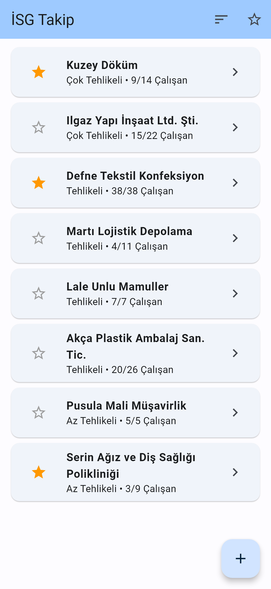
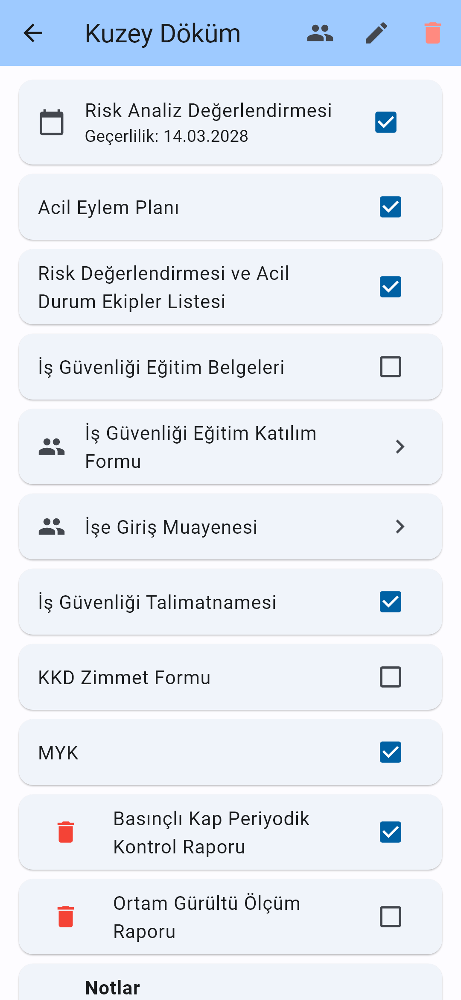
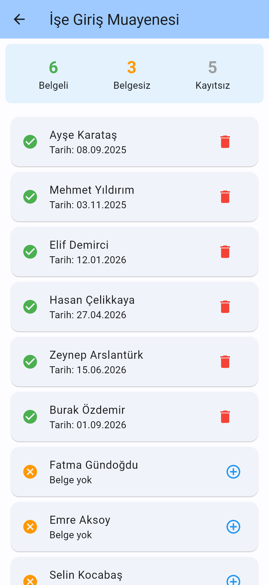

**English** | [Türkçe](README.tr.md)

# İSG Takip

An Android app for tracking occupational health and safety (OHS) paperwork across many companies. It shows which mandatory documents each company has, and which employees have completed training and pre-employment medical examinations.

## Background

The app grew out of the day-to-day work of an occupational physician who used to keep track of all of this on paper. It was built to replace those paper records and was used in practice, covering an estimated 50 to 100 companies. Feedback from the physician shaped the app during early development.

It was distributed directly as an APK, not through Google Play.

## Features

- **Company list.** Shows each company's name, hazard class and how many employees have been added out of the total. Companies can be starred, the list can be filtered to starred companies and sorted by employee count.
- **Hazard classes.** Less Hazardous, Hazardous and Very Hazardous (*Az Tehlikeli*, *Tehlikeli*, *Çok Tehlikeli*).
- **Standard documents.** Every new company starts with nine standard OHS documents, each marked as present or missing. They are the risk assessment, emergency action plan, emergency teams list, training certificates, training attendance form, pre-employment medical examination, safety instructions, PPE handover form and MYK vocational qualification.
- **Risk assessment validity date.** A date can be recorded for the risk assessment.
- **Per-employee records.** For the training attendance form and the pre-employment medical examination, a date is recorded for each employee. The screen shows how many employees have the document, how many don't, and how many haven't been added to the app yet.
- **Custom documents.** Company-specific documents can be added and removed.
- **Employee management.** Employees can be added and removed. Removing an employee also removes their records from every document.
- **Notes.** A free-text note can be kept for each company.
- **Works offline.** All data stays on the device. No account or internet connection is needed.

<!--
## Screenshots

Add the images under docs/screenshots/ and uncomment this section.

| Company list | Company detail | Employee records |
|---|---|---|
|  |  |  |
-->

## Tech stack

- [Flutter](https://flutter.dev) 3.10+ / Dart 3, Material 3
- [provider](https://pub.dev/packages/provider) for state management
- [shared_preferences](https://pub.dev/packages/shared_preferences) for on-device storage

## Architecture

The code is split into three layers.

```
lib/
├── models/      Sirket (company), Belge (document), Calisan (employee)
│                and tolerant JSON reading helpers
├── providers/   SirketProvider, which holds the business logic and persistence
├── screens/     home, company detail, employee management, document detail
├── widgets/     company form and custom document dialogs
└── utils/       date formatting and the date picker
```

- **Models** are plain Dart classes with `toJson`, `tryFromJson` and `copyWith`. Updates create new objects instead of changing existing ones.
- **`SirketProvider`** (a `ChangeNotifier`) holds the company list. Every change goes through it. It updates the list, saves it and notifies the UI.
- **Screens** read the current data from the provider with `Consumer`. A detail page always shows the latest state, even after edits made on other pages.

Identifiers and field names in the code are in Turkish, matching the domain terms used in Turkish OHS practice.

## Data storage

- All companies are stored as a single JSON array under one `shared_preferences` key (`sirketler`). There is no server or external database.
- Reading is tolerant of damaged data. Missing or wrongly typed fields fall back to defaults, records without an ID are skipped, and unknown values fall back to a safe default.
- If the stored data can't be read at all, the raw text is copied to a separate key (`sirketler_okunamayan_yedek`) before anything is overwritten.

## Getting started

You need the Flutter SDK (3.10 or newer) and an Android device or emulator.

```bash
flutter pub get
flutter run
```

Run the tests:

```bash
flutter test
```

Build an APK:

```bash
flutter build apk --release
```

The tests cover JSON round-trips, reading data saved by older versions, damaged data, and provider behaviour such as removing an employee's records when the employee is deleted.

## Known limitations

- **Data lives on one device only.** There is no backup, export or sync. Uninstalling the app or losing the phone loses the data.
- **Single user.** There are no accounts and no sharing between devices.
- **No reminders.** The risk assessment validity date is shown but doesn't trigger a warning when it expires.
- **Android only.** The project contains Flutter's other platform folders, but the app has only been used and tested on Android.
- **Turkish interface only.**
- **Release signing.** Release builds are currently signed with the debug key. A proper signing setup is needed before publishing to a store.
