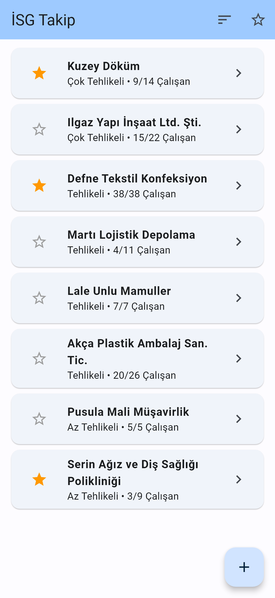
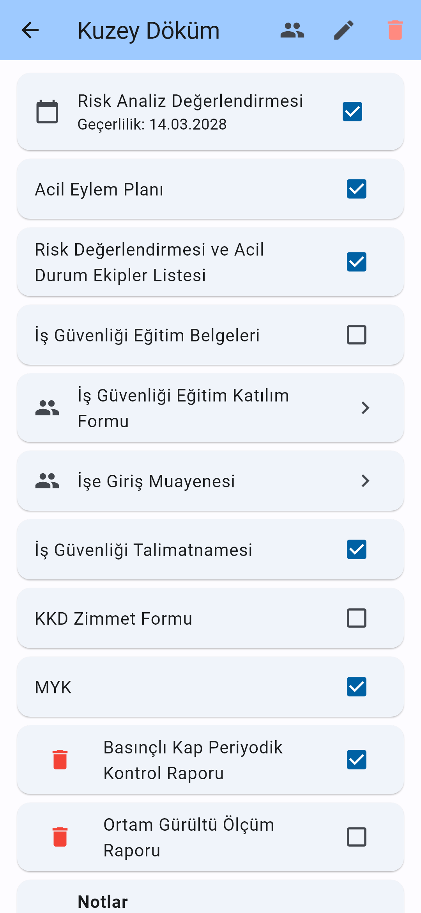
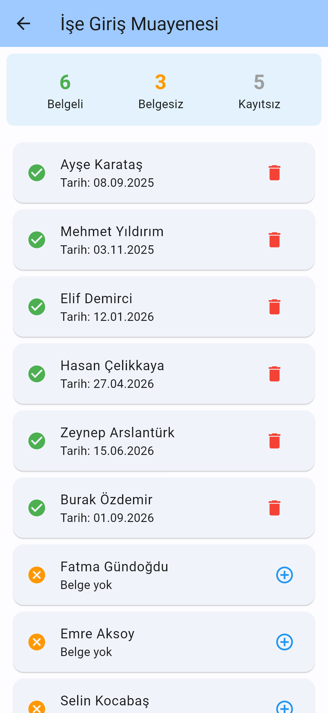

[English](README.md) | **Türkçe**

# İSG Takip

Birçok şirketin iş sağlığı ve güvenliği evrakını tek yerden takip etmek için yazılmış bir Android uygulaması. Her şirkette hangi zorunlu belgelerin tamam olduğunu, hangi çalışanın eğitimini ve işe giriş muayenesini yaptırdığını gösterir.

## Nasıl ortaya çıktı?

Uygulama, bir işyeri hekiminin günlük işinden doğdu. Hekim bu takibi daha önce fiziksel kâğıtlarla yapıyordu. Uygulama bu kâğıt kayıtların yerini almak için yazıldı ve sahada kullanıldı. Tahminen 50 ile 100 arasında şirketin takibi bu uygulamayla yapıldı. İlk geliştirme sürecinde hekimin geri bildirimleriyle şekillendi.

Google Play üzerinden değil, doğrudan APK olarak dağıtıldı.

## Özellikler

- **Şirket listesi.** Şirket adı, tehlike sınıfı ve toplam çalışanın kaçının eklendiği görünür. Şirketler yıldızlanabilir, liste sadece yıldızlılara göre süzülebilir ve çalışan sayısına göre sıralanabilir.
- **Tehlike sınıfları.** Az Tehlikeli, Tehlikeli, Çok Tehlikeli.
- **Standart belgeler.** Her yeni şirkete aşağıdaki dokuz standart İSG belgesi kendiliğinden eklenir ve her biri var ya da yok olarak işaretlenir.
  - Risk Analiz Değerlendirmesi
  - Acil Eylem Planı
  - Risk Değerlendirmesi ve Acil Durum Ekipler Listesi
  - İş Güvenliği Eğitim Belgeleri
  - İş Güvenliği Eğitim Katılım Formu
  - İşe Giriş Muayenesi
  - İş Güvenliği Talimatnamesi
  - KKD Zimmet Formu
  - MYK
- **Risk analizinin geçerlilik tarihi** kaydedilebilir.
- **Çalışan bazında takip.** Eğitim katılım formu ve işe giriş muayenesi için her çalışana ayrı tarih girilir. Ekranda belgesi olan, olmayan ve henüz uygulamaya eklenmemiş çalışan sayıları görünür.
- **Şirkete özel belgeler** eklenip silinebilir.
- **Çalışan yönetimi.** Çalışan eklenip silinebilir. Silinen çalışanın kayıtları bütün belgelerden de temizlenir.
- **Notlar.** Her şirket için serbest metin notu tutulabilir.
- **İnternetsiz çalışır.** Bütün veri cihazda durur, hesap ya da internet bağlantısı gerekmez.

## Ekran görüntüleri

| Şirket listesi | Şirket detayı | Çalışan kayıtları |
|---|---|---|
|  |  |  |

## Kullanılan teknolojiler

- [Flutter](https://flutter.dev) 3.10+ / Dart 3, Material 3
- Durum yönetimi için [provider](https://pub.dev/packages/provider)
- Cihaz içi kayıt için [shared_preferences](https://pub.dev/packages/shared_preferences)

## Mimari

Kod üç katmana ayrılır.

```
lib/
├── models/      Sirket, Belge, Calisan ve hataya dayanıklı JSON okuma yardımcıları
├── providers/   SirketProvider, iş kuralları ve kayıt işlemleri
├── screens/     ana sayfa, şirket detayı, çalışan yönetimi, belge detayı
├── widgets/     şirket formu ve özel belge pencereleri
└── utils/       tarih biçimlendirme ve tarih seçici
```

- **Modeller** `toJson`, `tryFromJson` ve `copyWith` içeren sade Dart sınıflarıdır. Güncellemede mevcut nesne değiştirilmez, yenisi oluşturulur.
- **`SirketProvider`** (`ChangeNotifier`) şirket listesini tutar. Her değişiklik buradan geçer. Liste güncellenir, kaydedilir ve arayüze haber verilir.
- **Ekranlar** güncel veriyi `Consumer` ile provider'dan okur. Böylece başka bir sayfada yapılan değişiklik detay sayfasına da hemen yansır.

## Veri saklama

- Bütün şirketler tek bir JSON dizisi olarak `shared_preferences` içinde tek bir anahtarda (`sirketler`) tutulur. Sunucu ya da harici bir veritabanı yoktur.
- Okuma, bozuk veriye karşı dayanıklıdır. Eksik ya da yanlış tipteki alanlar varsayılan değerle doldurulur, kimliği olmayan kayıtlar atlanır, tanınmayan değerler güvenli bir varsayılana döner.
- Kayıtlı veri hiç okunamazsa, üzerine bir şey yazılmadan önce ham hâli ayrı bir anahtara (`sirketler_okunamayan_yedek`) kopyalanır.

## Kurulum ve çalıştırma

Flutter SDK (3.10 ya da üstü) ve bir Android cihaz veya emülatör gerekir.

```bash
flutter pub get
flutter run
```

Testleri çalıştırmak için:

```bash
flutter test
```

APK almak için:

```bash
flutter build apk --release
```

Testler JSON'a yazıp geri okumayı, eski sürümün kaydettiği verinin okunmasını, bozuk veriyi ve provider davranışını (örneğin silinen çalışanın kayıtlarının belgelerden temizlenmesini) kapsar.

## Bilinen sınırlamalar

- **Veri tek cihazda durur.** Yedekleme, dışa aktarma ya da eşitleme yoktur. Uygulama silinirse ya da telefon kaybolursa veri de gider.
- **Tek kullanıcılıdır.** Hesap sistemi ve cihazlar arası paylaşım yoktur.
- **Hatırlatma yoktur.** Risk analizinin geçerlilik tarihi gösterilir ama süresi dolunca uyarı verilmez.
- **Sadece Android.** Projede Flutter'ın diğer platform klasörleri de var, ancak uygulama yalnızca Android'de kullanıldı ve test edildi.
- **Arayüz yalnızca Türkçedir.**
- **Yayın imzası.** Release derlemesi şu an debug anahtarıyla imzalanıyor. Bir mağazada yayımlamadan önce düzgün bir imzalama ayarı gerekir.
